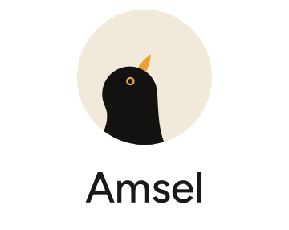

  <picture>
    <source media="(prefers-color-scheme: dark)" srcset="docs/design/readme/amsel-dark.svg">
    
  </picture>

  Amsel is the German word for blackbird. The blackbird is a plain-looking bird and is known mostly for its song.

  The app is a music player for Music Assistant on Android. It was started because a good player was needed, not for the fun of building one. That is also why it is not open source, since there is simply no interest in running a project. A lot of care goes into it all the same, and anyone is welcome to use it.

