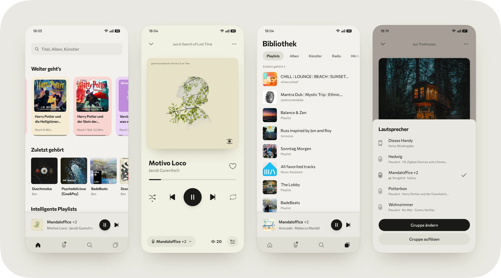

<picture>
  <source media="(prefers-color-scheme: dark)" srcset="docs/design/readme/header-dark.svg">
  
</picture>

 
 

Amsel is a music player for Music Assistant, made for Android. It comes in light and dark, and in English and German.

 

<picture>
  <source media="(prefers-color-scheme: dark)" srcset="docs/design/readme/screens-dark.webp">
  
</picture>

 
 

**The ideas behind it:**

- Pleasant design with minimal branding
- Adjustable interface, behaviour and widgets
- Easy speaker management and grouping

 The app is developed with the help of AI tools. It exists because the last missing piece of a music setup at home was a player for quite a specific taste and wish list, not because building one sounded like fun. Amsel is German for blackbird, a rather plain-looking bird known mostly for its song.
