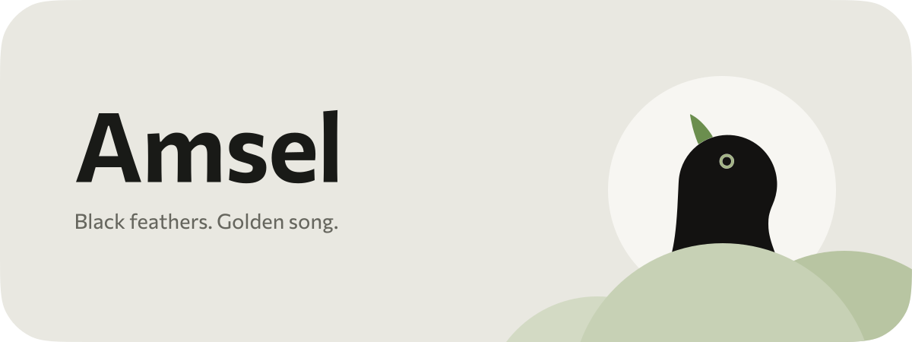

<picture>
  <source media="(prefers-color-scheme: dark)" srcset="docs/design/readme/header-dark.svg">
  
</picture>

Amsel is a small Android app that plays your Music Assistant library on your phone or on any speaker in the house. It exists because a good player was missing, not because building one sounded like fun.

### The ideas behind it

- What matters most is that it works, because the nicest app isn't worth much when the music stops.
- It should be easy to use, because you want to listen to music, not solve a puzzle.
- There's no loud branding and no AI look, and nothing in it is different just to be different.
- It's designed by a human for humans, and the ones at home are quick to say when something doesn't feel right.

 Amsel is the German word for blackbird. The blackbird is a plain-looking bird and is known mostly for its song.
